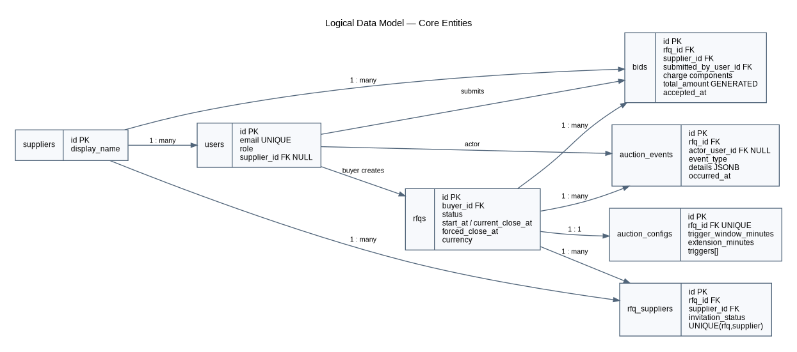
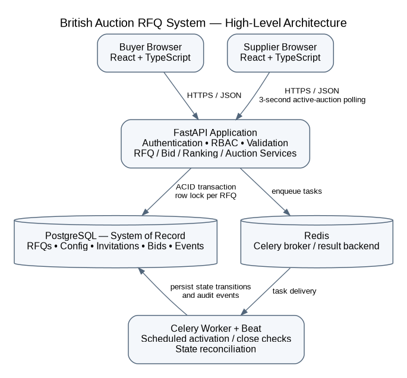

# SOFTWARE REQUIREMENTS SPECIFICATION

## British Auction in RFQ System

**Project:** GoComet — Full Stack Intern Assignment  
**Document version:** 1.0  
**Document date:** 15 November 2026  
**Status:** Implementation baseline  
**Prepared for:** Engineering handoff  
**Target stack:** Python 3.11+ / FastAPI / PostgreSQL / React + TypeScript / Redis + Celery

---

## Document control

| Version | Date | Change | Status |
|---|---|---|---|
| 1.0 | 15-Nov-2026 | Initial implementation-ready specification derived from the assignment brief and role description | Baseline |

**How to use this document:** Treat the numbered functional requirements, business rules, state transitions, API contracts, and acceptance criteria as the source of truth. Where the original assignment leaves behavior unspecified, this document makes an explicit MVP decision so implementation does not stall on interpretation. Any change to those decisions should be made deliberately and reflected in this document and tests.

## 0. Executive implementation brief

Build a role-based RFQ application with a reverse-auction experience. A buyer creates and publishes an RFQ, invites suppliers, and configures a British Auction. Invited suppliers submit progressively lower quotes. The system calculates each supplier's current rank, displays the live lowest price, automatically extends the current bid-close time when configured activity occurs in the trigger window, and never permits bidding after the forced-close timestamp.

### Non-negotiable correctness rules

1. PostgreSQL is the source of truth for bids, rankings, auction times, and activity history. Redis is not authoritative.
2. A bid is accepted only after the API has locked the RFQ row, read the database clock, and validated the auction window and supplier eligibility inside one database transaction.
3. A supplier's new total must be strictly lower than that supplier's previous accepted total. The bid does **not** have to beat the current L1; it may improve the supplier's position without becoming L1.
4. A supplier's current auction price is that supplier's latest accepted bid. Because of rule 3, it is also that supplier's lowest accepted price.
5. Current ranking is ordered by total price ascending, then by the timestamp of the current bid ascending, then by supplier ID ascending as a final deterministic tie-breaker. Ranks are unique: L1, L2, L3, etc.
6. Configure one or more extension triggers. They operate with **OR** semantics. One accepted bid can cause at most one extension, even when it matches multiple triggers.
7. The trigger window is evaluated against the **current** close time, including a close time that has already been extended: `[current_close_at - X minutes, current_close_at)`.
8. A qualifying bid extends `current_close_at` by Y minutes, capped at `forced_close_at`. The close time must never move past the forced close.
9. `now >= forced_close_at` means `FORCE_CLOSED`. Otherwise, `now >= current_close_at` means `CLOSED`. A bid is valid only when `start_at <= now < current_close_at` and `now < forced_close_at`.
10. Every accepted bid, rank change, extension, and closure is auditable. Rejected bids do not alter auction state and do not trigger an extension.

### MVP delivery boundary

**Must build:** authentication and role checks; buyer RFQ creation and publishing; supplier invitation/eligibility; bid submission; descending-price validation; deterministic ranking; all three extension trigger modes; forced close; listing/details pages; activity log; PostgreSQL schema; tests; Docker-based local run instructions.

**Do not build for this assignment:** payments, contract award/negotiation, invoicing, email/SMS delivery, file uploads, multi-currency conversion, Neo4j, complex procurement workflows, or machine-learning features. Do not add these as blockers to the auction flow.

---

## 1. Introduction

### 1.1 Purpose

This SRS defines the functional behavior, business rules, system architecture, data model, interfaces, validation, security, non-functional targets, and acceptance tests for the British Auction capability in an RFQ system. It is written so a development team can implement the assignment without inventing missing rules.

### 1.2 Scope

The product is a simplified buyer-to-supplier RFQ workflow. Each RFQ can be configured as a British Auction. Suppliers submit visible bids and compete by lowering quote totals. Auction extensions prevent last-second bidding and a forced close guarantees a hard stop.

### 1.3 Intended audience

- Product owner / assignment reviewer: scope and expected behavior.
- Backend engineer: transaction rules, API, schema, and job processing.
- Frontend engineer: screens, states, validation, and permissions.
- QA engineer: deterministic scenarios and acceptance tests.
- DevOps / evaluator: local deployment and runtime configuration.

### 1.4 Definitions

| Term | Definition |
|---|---|
| RFQ | Request for Quotation created by a buyer and sent to eligible suppliers. |
| British Auction | In this assignment, an open reverse auction in which suppliers lower their quote totals. |
| Bid | An immutable, accepted quote submission from one supplier for one RFQ. |
| Current bid | The latest accepted bid for a supplier in a given RFQ. |
| L1 | Supplier currently ranked first (lowest total evaluated price). |
| Trigger window (X) | The final X minutes before the current bid-close time during which configured activity can extend the auction. |
| Extension duration (Y) | Minutes added to the current close time when a trigger matches. |
| Forced close | Absolute hard-stop timestamp. No activity may extend beyond it. |
| Current close | The effective closing timestamp after zero or more extensions. |
| Rank change | A change in the rank number of any participating supplier after a newly accepted bid. |
| L1 change | The identity of the current L1 supplier changes after a newly accepted bid. |
| UTC | Canonical timezone for persisted timestamps and server-side comparisons. |

### 1.5 Assumptions and explicit MVP decisions

The source brief does not specify all operational details. The following decisions are part of this baseline:

1. One RFQ has one currency. All supplier charges for that RFQ use that currency. No currency conversion is performed.
2. Evaluated price is the sum of freight, origin, and destination charges. Transit time and quote validity are displayed but do not affect price ranking.
3. A supplier may submit multiple bids, but each accepted bid must strictly reduce that supplier's own latest accepted total. A supplier may improve its rank without becoming L1.
4. Identical current totals are ordered by the earlier accepted current bid. Supplier UUID is the final tie-breaker. There are no shared rank labels.
5. Buyers see supplier identities and full quote breakdowns. A supplier sees its own full quote, plus competitor totals and ranks under anonymous labels; it does not see competitors' identities or line-item breakdowns. This is the privacy-safe MVP interpretation of open price competition.
6. Only invited suppliers may view or bid on an RFQ. Invitation acceptance workflow is optional; being listed as an active invitee is sufficient to participate.
7. Auction configuration and schedule become immutable when the RFQ is published. A buyer must cancel a scheduled auction and create a replacement if material configuration changes are required. Active auctions cannot be edited or cancelled in the MVP.
8. Multiple selected extension triggers use OR logic. Matching multiple triggers on one accepted bid still produces one extension.
9. The current close time is the reference for each subsequent trigger window. An extension therefore moves the next trigger window forward.
10. All time comparisons use the PostgreSQL database clock in UTC, not the browser clock.
11. A quote's validity date must be on or after the RFQ service date. This prevents an otherwise winning quote from expiring before service.
12. The system uses polling every 3 seconds on active auction pages for the assignment MVP. WebSockets are not required.

---

## 2. Product overview

### 2.1 Actors and permissions

| Actor | Description | Allowed actions |
|---|---|---|
| Buyer | Owner/creator of an RFQ | Create/edit draft RFQ, configure auction, invite suppliers, publish, view all supplier identities and quote details, view events and rankings. |
| Invited supplier | Supplier associated with an RFQ through the invitation table | View that RFQ, submit bids during the active window, view own quote details, view anonymous competitor totals and ranks, view auction timing and eligible events. |
| Uninvited supplier | Supplier not associated with the RFQ | No access to RFQ details, bids, rankings, or events. |
| System worker | Background Celery worker | Activate scheduled auctions, close auctions, force-close auctions, append system events. It cannot submit supplier bids. |

### 2.2 Primary use cases

| ID | Use case | Primary actor | Result |
|---|---|---|---|
| UC-01 | Create RFQ | Buyer | Draft RFQ and auction configuration are persisted. |
| UC-02 | Invite suppliers and publish | Buyer | RFQ is scheduled or immediately active based on start time. |
| UC-03 | View auction | Buyer / invited supplier | Actor sees the correct role-specific listing and detail data. |
| UC-04 | Submit bid | Invited supplier | Valid bid is appended, ranking is recalculated, triggers are evaluated, and the event log is updated atomically. |
| UC-05 | Extend auction | System | Current close moves forward by Y minutes but never past forced close. |
| UC-06 | Close auction | System | Auction becomes normally closed or force closed. |
| UC-07 | Review outcome | Buyer / invited supplier | Latest prices, ranks, final close reason, and audit history are visible according to permissions. |

### 2.3 Success metrics

The system should capture the following measurable outcomes. They are reporting metrics, not prerequisites for accepting a bid:

| Metric | Definition | Data required |
|---|---|---|
| Accepted bids per RFQ | Total accepted bid rows divided by published RFQs in the reporting period. | Published RFQ count and immutable bid count. |
| Supplier participation rate | Invited suppliers with at least one accepted bid divided by all active invited suppliers. | `rfq_suppliers` and `bids`. |
| Final price improvement | For RFQs with at least one bid: `(initial lowest total - final lowest total) / initial lowest total * 100`. Initial lowest total is the lowest total after the first accepted bid per invited supplier cohort has been received; final lowest total is the L1 total at closure. | Bid history, final standings, closure timestamp. |
| Extension activity | Count and share of auctions with at least one extension; segment by matched trigger reason. | `EXTENSION_APPLIED` event details. |

For the assignment demo, display bid count, participating supplier count, current/final L1, and extension count on the auction detail page. Comparing price improvement between extended and non-extended auctions requires a sufficiently large, comparable dataset and should not be presented as causal proof from a single demo.

### 2.4 Out of scope

Awarding a winner, purchase-order creation, supplier onboarding/KYC, document attachments, negotiation messaging, invoices, payments, tax computation, multiple currencies, route optimization, graph database use, and external notification delivery are outside the required MVP.

---

## 3. Functional requirements

Priority: **P0** = mandatory for assignment acceptance; **P1** = expected supporting behavior; **P2** = optional enhancement.

### 3.1 Authentication and authorization

| ID | Priority | Requirement |
|---|---|---|
| FR-AUTH-01 | P0 | The application shall require an authenticated user for all non-public application routes. |
| FR-AUTH-02 | P0 | The system shall support at least two roles: `BUYER` and `SUPPLIER`. System worker actions shall use an internal service identity, not a browser role. |
| FR-AUTH-03 | P0 | A buyer shall access only RFQs that the buyer owns. |
| FR-AUTH-04 | P0 | A supplier shall access only RFQs for which its supplier profile is an active invitee. |
| FR-AUTH-05 | P0 | API authorization shall be enforced on the backend for every RFQ, bid, ranking, and event request. Hiding a frontend button is not authorization. |

### 3.2 RFQ creation and lifecycle

| ID | Priority | Requirement |
|---|---|---|
| FR-RFQ-01 | P0 | A buyer shall create an RFQ with name, reference ID, currency, bid start time, scheduled bid close time, forced bid close time, pickup/service date, invited suppliers, and British Auction configuration. |
| FR-RFQ-02 | P0 | The RFQ shall be created in `DRAFT` state. Draft data shall be editable by its owning buyer. |
| FR-RFQ-03 | P0 | The system shall validate `start_at < scheduled_close_at < forced_close_at`. Forced close must be strictly later than the originally scheduled close. |
| FR-RFQ-04 | P0 | On publish, the system shall freeze schedule, currency, invitee list, and auction configuration. |
| FR-RFQ-05 | P0 | On publish, the state shall become `SCHEDULED` when database time is before `start_at`; otherwise it shall become `ACTIVE` when `start_at <= now < current_close_at`. An expired RFQ shall not be published. |
| FR-RFQ-06 | P1 | A scheduled auction shall become `ACTIVE` when `start_at` is reached. |
| FR-RFQ-07 | P1 | A scheduled auction may be cancelled by its owner before start. An active or closed auction cannot be cancelled in the MVP. |
| FR-RFQ-08 | P0 | The listing shall display RFQ name/reference, current lowest bid (or “No bids”), current close, forced close, and auction status. |

### 3.3 Auction configuration

| ID | Priority | Requirement |
|---|---|---|
| FR-CFG-01 | P0 | Buyer shall set trigger window X in whole minutes; X must be at least 1. |
| FR-CFG-02 | P0 | Buyer shall set extension duration Y in whole minutes; Y must be at least 1. |
| FR-CFG-03 | P0 | Buyer shall select one or more triggers from `BID_RECEIVED`, `ANY_RANK_CHANGE`, and `L1_CHANGE`. |
| FR-CFG-04 | P0 | If multiple triggers are selected, a bid qualifies when any selected trigger matches (OR semantics). |
| FR-CFG-05 | P0 | Auction configuration shall be immutable after publish. |
| FR-CFG-06 | P0 | Extension logic shall never set `current_close_at` later than `forced_close_at`. |

### 3.4 Supplier eligibility and bid submission

| ID | Priority | Requirement |
|---|---|---|
| FR-BID-01 | P0 | Only an invited supplier may submit a bid for an RFQ. |
| FR-BID-02 | P0 | A bid shall include freight charge, origin charge, destination charge, transit time in days, and quote validity date. |
| FR-BID-03 | P0 | All charges shall be non-negative decimal values with a maximum precision of two decimal places. Floating-point arithmetic shall not be used for money. |
| FR-BID-04 | P0 | The server shall calculate `total_amount = freight_charge + origin_charge + destination_charge`; a client-provided total shall be ignored or rejected. |
| FR-BID-05 | P0 | The total shall use the RFQ's single configured currency. |
| FR-BID-06 | P0 | Transit time shall be a whole number of days greater than or equal to zero. |
| FR-BID-07 | P0 | Quote validity date shall be on or after the RFQ service date. |
| FR-BID-08 | P0 | Bid may be accepted only when `start_at <= database_now < current_close_at` and `database_now < forced_close_at`. |
| FR-BID-09 | P0 | For the supplier's first bid, no previous-price comparison is required. Each subsequent accepted bid must have `new_total < supplier_latest_accepted_total`. Equal or higher totals shall be rejected. |
| FR-BID-10 | P0 | A supplier's accepted bid shall be immutable. Corrections must be submitted as a new lower bid. |
| FR-BID-11 | P0 | The bid endpoint shall support an idempotency key so a network retry cannot create a duplicate accepted bid. |
| FR-BID-12 | P0 | A rejected bid shall not change the close time, ranking, current bid, or event log. |
| FR-BID-13 | P0 | The server shall return the accepted bid, updated rank, current L1, current close time, and whether an extension occurred. |

### 3.5 Ranking and lowest bid

| ID | Priority | Requirement |
|---|---|---|
| FR-RANK-01 | P0 | The current bid per supplier shall be the latest accepted bid for that supplier and RFQ. |
| FR-RANK-02 | P0 | Suppliers shall be ordered by current total ascending. |
| FR-RANK-03 | P0 | If two suppliers have equal current totals, the supplier whose current bid was accepted earlier shall rank higher. Supplier ID ascending is the final tie-breaker. |
| FR-RANK-04 | P0 | Ranking labels shall be unique and sequential: L1, L2, L3, etc. |
| FR-RANK-05 | P0 | The current lowest bid shall be the total of the current L1 supplier. When no bid exists, display “No bids”. |
| FR-RANK-06 | P0 | After every accepted bid, the system shall compare pre-bid and post-bid ranks to identify rank changes and L1 identity changes. |
| FR-RANK-07 | P1 | Buyer shall see supplier name, current bid components, total, transit time, validity, and rank. |
| FR-RANK-08 | P0 | Supplier shall see its own complete quote and other suppliers' rank and total only, under anonymous labels. |

### 3.6 Automatic extension behavior

| ID | Priority | Requirement |
|---|---|---|
| FR-EXT-01 | P0 | The system shall evaluate extension triggers only after a bid passes all validation and is accepted. |
| FR-EXT-02 | P0 | Trigger window is `[current_close_at - X minutes, current_close_at)`, evaluated at the time the bid transaction obtains the RFQ lock. |
| FR-EXT-03 | P0 | `BID_RECEIVED` matches every accepted bid inside the trigger window. |
| FR-EXT-04 | P0 | `ANY_RANK_CHANGE` matches when at least one supplier's rank number differs between the pre-bid and post-bid standings. A new supplier entering the ranking counts as a rank change. |
| FR-EXT-05 | P0 | `L1_CHANGE` matches when the identity of the L1 supplier differs before and after the bid. Transition from no L1 to a first L1 counts. A lower bid by the same L1 supplier does not by itself count as an L1 change. |
| FR-EXT-06 | P0 | When any configured trigger matches, the system shall calculate `new_close = min(old_current_close + Y minutes, forced_close_at)`. |
| FR-EXT-07 | P0 | The system shall create no more than one extension for a single accepted bid, even if multiple selected triggers match. All matching trigger reasons shall be recorded. |
| FR-EXT-08 | P0 | If the forced-close cap leaves no positive extension, no extension shall be applied. The accepted bid remains valid if it was received before the previous current close. |
| FR-EXT-09 | P0 | Every successful extension shall be recorded with previous close, new close, forced close, Y, triggering bid ID, and matched reason(s). |
| FR-EXT-10 | P0 | The next bid shall be evaluated against the newly updated current close, not the original scheduled close. |

### 3.7 Closure and status

| ID | Priority | Requirement |
|---|---|---|
| FR-STATE-01 | P0 | Valid states shall be `DRAFT`, `SCHEDULED`, `ACTIVE`, `CLOSED`, `FORCE_CLOSED`, and `CANCELLED`. |
| FR-STATE-02 | P0 | If `database_now >= forced_close_at`, state shall be `FORCE_CLOSED`, regardless of current close. |
| FR-STATE-03 | P0 | Otherwise, if `database_now >= current_close_at`, state shall be `CLOSED`. |
| FR-STATE-04 | P0 | Otherwise, if `database_now >= start_at` and the auction is published, state shall be `ACTIVE`. |
| FR-STATE-05 | P0 | Otherwise a published auction before its start time shall be `SCHEDULED`. |
| FR-STATE-06 | P0 | No bid shall be accepted after normal close or forced close. |
| FR-STATE-07 | P1 | A closed auction shall display final current standings and whether it ended normally or at the forced close. If there are no bids, the result shall be “No bids received”. |

### 3.8 Listing, details, and activity history

| ID | Priority | Requirement |
|---|---|---|
| FR-UI-01 | P0 | The auction listing shall show RFQ name/reference, current lowest bid, current close, forced close, and status. |
| FR-UI-02 | P0 | Auction details shall show schedule, configuration X/Y, selected triggers, current countdown, current standings, and bid history. |
| FR-UI-03 | P0 | Buyer bid history shall be sortable by price and show full supplier quote details. |
| FR-UI-04 | P0 | Supplier bid history shall apply the supplier visibility rules in section 2.1 and 3.5. |
| FR-UI-05 | P0 | Activity history shall include accepted bid submissions, ranking changes, time extensions with reason, normal close, and forced close. |
| FR-UI-06 | P0 | Active auction pages shall refresh standings and countdown at least every 3 seconds. A refresh must not create or modify bids. |
| FR-UI-07 | P1 | Empty, loading, error, scheduled, active, closed, force-closed, and no-bid states shall be explicitly designed. |

---

## 4. Business rules and validation catalogue

| Rule ID | Rule | Enforcement layer | Failure behavior |
|---|---|---|---|
| BR-01 | `start_at < scheduled_close_at < forced_close_at`. | API schema + DB checks where practical | Reject RFQ save/publish with field-level message. |
| BR-02 | `trigger_window_minutes >= 1`. | API schema + DB check | Reject configuration. |
| BR-03 | `extension_duration_minutes >= 1`. | API schema + DB check | Reject configuration. |
| BR-04 | At least one valid extension trigger is required. | API schema + DB check | Reject configuration. |
| BR-05 | Only active invitees may access or bid. | Service authorization | Return 403; do not reveal RFQ data. |
| BR-06 | Charge values are decimal, non-negative, and have at most 2 decimal places. | API schema + DB numeric columns/checks | Return 422. |
| BR-07 | Server computes total as the sum of the three charges. | Domain service + generated DB column | Ignore/reject caller total. |
| BR-08 | Quote validity date is on or after service date. | Domain service | Return 422. |
| BR-09 | Every supplier bid after its first is strictly lower than its previous accepted total. | Transactional domain service | Return 409 `BID_NOT_LOWER_THAN_PREVIOUS`. |
| BR-10 | Bid accepted only when start time has arrived and current/forced close have not arrived. | Transactional domain service using DB clock | Return 409 `AUCTION_NOT_STARTED` or `AUCTION_CLOSED`. |
| BR-11 | Every supplier has one current bid per RFQ for ranking purposes. | Ranking query | Use latest accepted bid only. |
| BR-12 | Rank ordering is total ascending, current bid time ascending, supplier ID ascending. | Ranking query | Deterministic unique ranks. |
| BR-13 | Trigger window is relative to current close, not scheduled/original close. | Domain service | Evaluate immediately before applying extension. |
| BR-14 | Selected triggers are OR-combined. | Domain service | One or more matches qualify. |
| BR-15 | One accepted bid causes at most one extension. | Transactional domain service | Consolidate reasons into one extension event. |
| BR-16 | New close is `min(old close + Y, forced close)`. | Transactional domain service + DB check | Never exceed cap. |
| BR-17 | A bid accepted before a closing instant stays accepted even if response is delivered after it. | Database transaction | Commit result is authoritative. |
| BR-18 | Idempotent retry returns the original accepted bid and does not re-run extension logic. | Bid endpoint + unique constraint | Return original result. |
| BR-19 | Published RFQ schedule/configuration/invitees are immutable. | API service + DB-level safeguards where practical | Return 409 `RFQ_IMMUTABLE`. |
| BR-20 | System timestamps are UTC and generated by server/database. | DB defaults + service | Never trust a client timestamp for accepted_at or closure. |

### 4.1 Form-level validation messages

- **Start time:** “Bid start must be earlier than bid close.”
- **Bid close:** “Bid close must be later than bid start and earlier than forced close.”
- **Forced close:** “Forced close must be later than the scheduled bid close.”
- **Trigger window:** “Enter a whole number of minutes greater than zero.”
- **Extension duration:** “Enter a whole number of minutes greater than zero.”
- **Triggers:** “Select at least one extension trigger.”
- **Charge:** “Enter a non-negative amount with up to two decimal places.”
- **Transit time:** “Enter a whole number of days greater than or equal to zero.”
- **Quote validity:** “Quote validity must cover the RFQ service date.”
- **Non-improving bid:** “Your new total must be lower than your previous accepted total.”
- **Closed auction:** “This auction is closed. New bids are no longer accepted.”

---

## 5. Auction lifecycle and state machine

### 5.1 State definitions

| State | Meaning | Can supplier bid? | Can buyer edit? |
|---|---|---:|---:|
| `DRAFT` | Created but not published | No | Yes |
| `SCHEDULED` | Published; start time is in the future | No | No |
| `ACTIVE` | Published; start has arrived; current close and forced close are still in the future | Yes, if invited | No |
| `CLOSED` | Current close reached before forced close | No | No |
| `FORCE_CLOSED` | Forced close reached | No | No |
| `CANCELLED` | Scheduled auction cancelled by buyer before start | No | No |

### 5.2 Allowed transitions

| From | Event / condition | To | Actor |
|---|---|---|---|
| DRAFT | Publish and `now < start_at` | SCHEDULED | Buyer |
| DRAFT | Publish and `start_at <= now < current_close_at` | ACTIVE | Buyer |
| SCHEDULED | `now >= start_at` and `now < current_close_at` | ACTIVE | Worker / read-time state reconciliation |
| ACTIVE | `now >= current_close_at` and `now < forced_close_at` | CLOSED | Worker / read-time state reconciliation |
| ACTIVE | `now >= forced_close_at` | FORCE_CLOSED | Worker / read-time state reconciliation |
| SCHEDULED | Buyer cancels before start | CANCELLED | Buyer |

No transition from CLOSED or FORCE_CLOSED back to ACTIVE is allowed. No bid can reopen an auction. An extension is possible only while the auction is still active and a bid was accepted before the then-current close.

### 5.3 Status evaluation precedence

Evaluate in this exact order using one database timestamp:

1. If state is `CANCELLED` or `DRAFT`, retain that state.
2. If `now >= forced_close_at`, state is `FORCE_CLOSED`.
3. Else if `now >= current_close_at`, state is `CLOSED`.
4. Else if `now >= start_at`, state is `ACTIVE`.
5. Else state is `SCHEDULED`.

The forced-close check must run before normal close. This ensures an auction whose current close has been capped to the forced-close timestamp ends as `FORCE_CLOSED` rather than `CLOSED`.

---

## 6. Core workflows

### 6.1 Buyer creates and publishes an RFQ

1. Buyer opens **Create RFQ**.
2. Buyer enters RFQ name/reference, currency, bid start, scheduled close, forced close, pickup/service date, and supplier invitees.
3. Buyer configures X, Y, and at least one extension trigger.
4. Frontend performs immediate field validation; backend repeats every validation.
5. Backend creates RFQ in `DRAFT`, stores auction config, and stores invited suppliers.
6. Buyer reviews and publishes. Backend validates all fields again and freezes the configuration.
7. Backend sets status to `SCHEDULED` or `ACTIVE` based on database time and appends a `PUBLISHED` event.
8. The listing displays the current close (initially equal to scheduled close) and forced close.

### 6.2 Supplier submits a bid

1. Supplier opens an invited RFQ detail page.
2. UI shows current close, forced close, countdown, current L1 total, supplier's own last accepted total, and permitted bidding controls.
3. Supplier enters freight, origin, and destination charges, transit days, and quote validity.
4. Frontend calculates a preview total for usability only. Server calculation is authoritative.
5. Frontend sends `POST /rfqs/{rfq_id}/bids` with an idempotency key.
6. Backend checks authentication and invitee status, then starts a DB transaction.
7. Backend locks the RFQ row using `SELECT ... FOR UPDATE` and reads `clock_timestamp()` after the lock is acquired.
8. Backend checks that the auction is active and that the current time is before both current close and forced close.
9. Backend validates quote fields and checks the supplier's previous accepted bid.
10. Backend captures the pre-bid standings, inserts the immutable bid, and recalculates standings.
11. Backend identifies any rank changes and whether the L1 supplier identity changed.
12. Backend evaluates configured triggers against the current close. If a trigger matches, it applies at most one capped extension.
13. Backend appends `BID_SUBMITTED`, rank-change, and extension events as applicable in the same transaction.
14. Backend commits and returns the bid, new standings, effective close, trigger reasons, and extension result.
15. The UI refreshes its listing and activity feed.

### 6.3 Extension calculation

```text
trigger_start = current_close_at - X minutes
inside_window = (database_now >= trigger_start) AND (database_now < current_close_at)

matches = []
IF BID_RECEIVED is configured:
    matches += [BID_RECEIVED]
IF ANY_RANK_CHANGE is configured AND any supplier rank changed:
    matches += [ANY_RANK_CHANGE]
IF L1_CHANGE is configured AND l1_supplier_before != l1_supplier_after:
    matches += [L1_CHANGE]

IF inside_window AND matches is not empty:
    proposed_close = current_close_at + Y minutes
    new_close = MIN(proposed_close, forced_close_at)
    IF new_close > current_close_at:
        current_close_at = new_close
        write one EXTENSION_APPLIED event with every matched reason
    ELSE:
        do not extend; the forced-close cap has already been reached
```

**Important:** `BID_RECEIVED` is an accepted-bid event. Invalid or rejected requests never qualify. If two suppliers submit at nearly the same time, the RFQ row lock serializes their transactions. Each transaction evaluates against the close time left by the transaction committed immediately before it.

### 6.4 Auction close

- The bid endpoint itself rejects a bid once the authoritative database time reaches current close or forced close. The system does not depend on a scheduler to enforce the deadline.
- Celery Beat schedules periodic reconciliation. A Celery task locks due RFQ rows and persists `ACTIVE -> CLOSED` or `ACTIVE -> FORCE_CLOSED` transitions with one closure event.
- Listing/detail reads may also calculate the effective state from timestamps so the UI is correct even if a worker is delayed. The next worker run persists the transition.
- No-bid auctions still close normally or by forced close and show “No bids received”.

---

## 7. User interface requirements

### 7.1 Navigation

- Buyer navigation: `Dashboard`, `My RFQs`, `Create RFQ`.
- Supplier navigation: `Invited Auctions`, `My Bids`.
- Auction detail is accessible only after backend permission checks.

### 7.2 Buyer: Create RFQ page

**Section A — RFQ details**
- RFQ Name (required text).
- Reference ID (required, unique within buyer account; trim whitespace).
- Currency (required ISO-4217 code; fixed for the RFQ).
- Pickup / Service Date (required date).

**Section B — Schedule**
- Bid Start Date & Time.
- Bid Close Date & Time.
- Forced Bid Close Date & Time.
- Show timezone label next to all date/time values. Convert browser-local input to an offset-aware ISO 8601 timestamp before API submission.

**Section C — Supplier access**
- Multi-select supplier list.
- At least one supplier required for publish.
- Display selected supplier count.

**Section D — British Auction rules**
- Trigger Window X (minutes).
- Extension Duration Y (minutes).
- Trigger checkboxes: Bid received in last X minutes; Any supplier rank change in last X minutes; L1 supplier change in last X minutes.
- Display helper text: “When multiple triggers are selected, any one matching trigger extends the auction. One bid causes at most one extension.”
- Display helper text: “The auction never extends beyond forced close.”

**Actions:** `Save Draft`, `Preview`, `Publish Auction`. Publish requires a confirmation summary. After publishing, schedule/configuration/supplier list are read-only.

### 7.3 Auction listing page

Required columns:

| Column | Display rule |
|---|---|
| RFQ Name / ID | Link to detail page. |
| Current Lowest Bid | Amount + RFQ currency; “No bids” when empty. |
| Current Bid Close | Effective close after extensions. |
| Forced Close | Absolute cap timestamp. |
| Status | Scheduled / Active / Closed / Force Closed. |
| Action | View auction. |

- Default sort: active auctions first, then nearest current close.
- Support pagination and status filter.
- Empty state: “No auctions found.”
- For suppliers, list only invited RFQs.

### 7.4 Auction detail page

**Header:** RFQ name/reference, status badge, service date, currency, current countdown, current close, forced close. For active auction, countdown is calculated from server-returned timestamps; client countdown is display-only.

**Summary tiles:** Current L1 total, number of participating suppliers, accepted bid count, effective close time.

**Standings table:**
- Buyer columns: Rank, Supplier, Freight, Origin, Destination, Total, Transit Days, Valid Until, Last Bid Time.
- Supplier columns: Rank, Anonymous Supplier Label, Total, Last Bid Time. For the logged-in supplier only, also show line-item charges, transit days, and validity.
- Sorting default: rank ascending.

**Submit bid panel (supplier only):** Freight charge, origin charge, destination charge, transit days, quote validity, calculated total preview, previous own total, and `Submit Bid` action. Disable form before start, after close, for uninvited suppliers, and while a submission is in progress. Do not disable based solely on client countdown; backend is authoritative.

**Auction configuration panel:** Trigger window X, extension duration Y, selected triggers, original scheduled close, current close, forced close.

**Activity panel:** Chronological feed of accepted bid, rank change, extension, normal close, and forced close events. Each extension entry must show previous close, new close, and reason(s).

### 7.5 UI states and error handling

| State | Required UI behavior |
|---|---|
| Loading | Skeleton or spinner; do not flash incorrect “No bids” content. |
| No bids | Show “No bids received yet”; no rank rows. |
| Scheduled | Show start time and countdown to start; disable bid form. |
| Active | Show current standings and countdown; enable bid form for invited suppliers. |
| Closed | Disable bid form; show final standings. |
| Force closed | Disable bid form; show “Forced close reached” and final standings. |
| Bid rejected: not lower | Show exact rejection message; keep entered values so supplier can correct them. |
| Bid rejected: closed | Refresh auction immediately and disable form. |
| Network error | Show retry action; retry with the same idempotency key for the same submission. |
| Permission denied | Show generic access-denied page; do not leak RFQ or supplier data. |

---

## 8. API specification

**Base path:** `/api/v1`  
**Content type:** `application/json`  
**Time format:** RFC 3339 / ISO 8601 with timezone offset; backend stores `TIMESTAMPTZ` in UTC.  
**Money format:** decimal strings in JSON, e.g. `"1250.50"`; never JavaScript floating-point as the source of truth.

### 8.1 Endpoint inventory

| Method | Endpoint | Role | Purpose |
|---|---|---|---|
| POST | `/auth/login` | Public | Authenticate and return access token. |
| GET | `/me` | Authenticated | Return user and role context. |
| POST | `/rfqs` | Buyer | Create draft RFQ, configuration, and invitee list. |
| PATCH | `/rfqs/{rfq_id}` | Buyer owner | Update draft RFQ only. |
| POST | `/rfqs/{rfq_id}/publish` | Buyer owner | Validate and publish RFQ. |
| POST | `/rfqs/{rfq_id}/cancel` | Buyer owner | Cancel scheduled RFQ before start. |
| GET | `/rfqs` | Buyer / Supplier | List owned RFQs or invited RFQs. |
| GET | `/rfqs/{rfq_id}` | Buyer owner / invitee | RFQ and auction summary. |
| GET | `/rfqs/{rfq_id}/standings` | Buyer owner / invitee | Current per-supplier ranks with role-based field visibility. |
| GET | `/rfqs/{rfq_id}/bids` | Buyer owner / invitee | Bid history with role-based field visibility and pagination. |
| POST | `/rfqs/{rfq_id}/bids` | Invited supplier | Submit a new bid. |
| GET | `/rfqs/{rfq_id}/events` | Buyer owner / invitee | Activity feed; supports cursor. |

### 8.2 Create RFQ request

```json
{
  "name": "Mumbai to Singapore Freight",
  "reference_id": "RFQ-2026-001",
  "currency": "USD",
  "service_date": "2026-12-10",
  "start_at": "2026-11-16T10:00:00+05:30",
  "scheduled_close_at": "2026-11-16T18:00:00+05:30",
  "forced_close_at": "2026-11-16T18:30:00+05:30",
  "supplier_ids": ["sup-uuid-1", "sup-uuid-2"],
  "auction_config": {
    "trigger_window_minutes": 10,
    "extension_duration_minutes": 5,
    "triggers": ["BID_RECEIVED", "L1_CHANGE"]
  }
}
```

**Response:** `201 Created` with `rfq_id`, `status: DRAFT`, `current_close_at` initialized to scheduled close, and normalized configuration.

### 8.3 Submit bid request

Header: `Idempotency-Key: <unique-client-generated-value>`

```json
{
  "freight_charge": "900.00",
  "origin_charge": "75.00",
  "destination_charge": "125.00",
  "transit_time_days": 4,
  "valid_until": "2026-12-15"
}
```

Do not accept `total_amount`, supplier ID, `accepted_at`, rank, or close time from the client. Supplier identity comes from the authenticated user; timestamps/rank/close are server-generated.

**Successful response:** `201 Created`

```json
{
  "bid_id": "bid-uuid",
  "rfq_id": "rfq-uuid",
  "total_amount": "1100.00",
  "currency": "USD",
  "accepted_at": "2026-11-16T12:55:03.231Z",
  "rank": "L2",
  "current_l1_total": "1050.00",
  "current_close_at": "2026-11-16T13:05:00.000Z",
  "extension": {
    "applied": true,
    "previous_close_at": "2026-11-16T13:00:00.000Z",
    "new_close_at": "2026-11-16T13:05:00.000Z",
    "matched_triggers": ["BID_RECEIVED", "L1_CHANGE"],
    "capped_by_forced_close": false
  }
}
```

The response is illustrative; timestamps and amounts are example values only. `rank` may be any current rank and `extension.applied` may be false.

### 8.4 Error response format

```json
{
  "error": {
    "code": "BID_NOT_LOWER_THAN_PREVIOUS",
    "message": "Your new total must be lower than your previous accepted total.",
    "details": {
      "previous_total": "1200.00",
      "submitted_total": "1250.00"
    },
    "request_id": "req-uuid"
  }
}
```

### 8.5 HTTP status and error codes

| HTTP | Code | Meaning |
|---:|---|---|
| 400 | `VALIDATION_ERROR` | Malformed payload or field validation failed. |
| 401 | `UNAUTHENTICATED` | Missing/invalid authentication. |
| 403 | `FORBIDDEN` | Authenticated user lacks buyer ownership or supplier invitation. |
| 404 | `RFQ_NOT_FOUND` | RFQ does not exist or is intentionally hidden by authorization policy. |
| 409 | `RFQ_IMMUTABLE` | Attempt to edit a published RFQ. |
| 409 | `AUCTION_NOT_STARTED` | Bid submitted before start. |
| 409 | `AUCTION_CLOSED` | Current or forced close has been reached. |
| 409 | `BID_NOT_LOWER_THAN_PREVIOUS` | New supplier total is not strictly lower than previous accepted total. |
| 409 | `IDEMPOTENCY_CONFLICT` | Same idempotency key reused with a different payload. |
| 422 | `INVALID_QUOTE` | Invalid money, transit, or validity values. |
| 429 | `RATE_LIMITED` | Request rate limit exceeded. |
| 500 | `INTERNAL_ERROR` | Unexpected server error; include request ID for support. |

### 8.6 Pagination and sorting

Use cursor pagination for bid/event history: `?limit=50&after_id=<last_seen_id>`. Cap `limit` at 100. Standings are returned as one ranked list per RFQ; if supplier count grows substantially, pagination may be added, but the assignment MVP may return all standings. API sorting is server-controlled; frontend must not be the authority for rank ordering.

---

## 9. Database schema design

### 9.1 Database conventions

- PostgreSQL 15+ recommended.
- Primary keys: UUID (`gen_random_uuid()`), except append-only event sequence may use `BIGSERIAL` for stable chronological cursors.
- All timestamps: `TIMESTAMPTZ`, stored/compared in UTC.
- Money: `NUMERIC(14,2)`; never `FLOAT`, `REAL`, or JavaScript number for authoritative values.
- Use foreign keys and check constraints for integrity.
- Use Alembic migrations; never create/alter production tables manually.
- Bids and auction events are append-only. Do not update or delete accepted bids.

### 9.2 Core tables

#### `suppliers`

| Column | Type | Constraints / notes |
|---|---|---|
| id | UUID | PK |
| display_name | VARCHAR(200) | NOT NULL |
| legal_name | VARCHAR(250) | Nullable for MVP |
| created_at | TIMESTAMPTZ | NOT NULL DEFAULT `clock_timestamp()` |
| is_active | BOOLEAN | NOT NULL DEFAULT TRUE |

#### `users`

| Column | Type | Constraints / notes |
|---|---|---|
| id | UUID | PK |
| email | CITEXT / VARCHAR(320) | NOT NULL UNIQUE |
| password_hash | TEXT | NOT NULL; never store plain password |
| display_name | VARCHAR(200) | NOT NULL |
| role | VARCHAR(20) | CHECK IN (`BUYER`, `SUPPLIER`) |
| supplier_id | UUID | FK `suppliers.id`, nullable for buyers; required for supplier users |
| is_active | BOOLEAN | NOT NULL DEFAULT TRUE |
| created_at | TIMESTAMPTZ | NOT NULL DEFAULT `clock_timestamp()` |

#### `rfqs`

| Column | Type | Constraints / notes |
|---|---|---|
| id | UUID | PK |
| buyer_id | UUID | FK `users.id`, NOT NULL |
| name | VARCHAR(250) | NOT NULL |
| reference_id | VARCHAR(100) | NOT NULL; unique per buyer |
| currency | CHAR(3) | NOT NULL; ISO-4217 code |
| service_date | DATE | NOT NULL |
| start_at | TIMESTAMPTZ | NOT NULL |
| scheduled_close_at | TIMESTAMPTZ | NOT NULL |
| current_close_at | TIMESTAMPTZ | NOT NULL; initially equals scheduled close |
| forced_close_at | TIMESTAMPTZ | NOT NULL |
| status | VARCHAR(20) | NOT NULL; allowed state values |
| published_at | TIMESTAMPTZ | Nullable until publish |
| created_at | TIMESTAMPTZ | NOT NULL DEFAULT `clock_timestamp()` |
| updated_at | TIMESTAMPTZ | NOT NULL DEFAULT `clock_timestamp()` |

Constraints: `start_at < scheduled_close_at`; `scheduled_close_at < forced_close_at`; `current_close_at <= forced_close_at`; `UNIQUE(buyer_id, reference_id)`.

#### `auction_configs`

| Column | Type | Constraints / notes |
|---|---|---|
| id | UUID | PK |
| rfq_id | UUID | FK `rfqs.id`, NOT NULL UNIQUE |
| trigger_window_minutes | SMALLINT | NOT NULL CHECK `> 0` |
| extension_duration_minutes | SMALLINT | NOT NULL CHECK `> 0` |
| triggers | TEXT[] | NOT NULL; non-empty; values restricted to the three supported triggers |
| created_at | TIMESTAMPTZ | NOT NULL DEFAULT `clock_timestamp()` |

#### `rfq_suppliers`

| Column | Type | Constraints / notes |
|---|---|---|
| id | UUID | PK |
| rfq_id | UUID | FK `rfqs.id`, NOT NULL |
| supplier_id | UUID | FK `suppliers.id`, NOT NULL |
| invitation_status | VARCHAR(20) | NOT NULL DEFAULT `ACTIVE`; allowed `ACTIVE`, `DECLINED`, `REVOKED` |
| invited_at | TIMESTAMPTZ | NOT NULL DEFAULT `clock_timestamp()` |
| UNIQUE | — | `UNIQUE(rfq_id, supplier_id)` |

Only `ACTIVE` invitation rows grant access and bidding rights. The MVP may create invitation rows directly as `ACTIVE` without building an acceptance workflow.

#### `bids`

| Column | Type | Constraints / notes |
|---|---|---|
| id | UUID | PK |
| rfq_id | UUID | FK `rfqs.id`, NOT NULL |
| supplier_id | UUID | FK `suppliers.id`, NOT NULL |
| submitted_by_user_id | UUID | FK `users.id`, NOT NULL |
| freight_charge | NUMERIC(14,2) | NOT NULL CHECK `>= 0` |
| origin_charge | NUMERIC(14,2) | NOT NULL CHECK `>= 0` |
| destination_charge | NUMERIC(14,2) | NOT NULL CHECK `>= 0` |
| total_amount | NUMERIC(14,2) | GENERATED ALWAYS AS sum of three charges STORED |
| transit_time_days | INTEGER | NOT NULL CHECK `>= 0` |
| valid_until | DATE | NOT NULL |
| idempotency_key | VARCHAR(128) | NOT NULL |
| accepted_at | TIMESTAMPTZ | NOT NULL DEFAULT `clock_timestamp()` |
| UNIQUE | — | `UNIQUE(rfq_id, supplier_id, idempotency_key)` |

Accepted rows are immutable. Ensure the authenticated user belongs to `supplier_id` before insertion. `valid_until >= rfqs.service_date` is enforced in service logic because it depends on another table.

#### `auction_events`

| Column | Type | Constraints / notes |
|---|---|---|
| id | BIGSERIAL | PK; stable cursor |
| rfq_id | UUID | FK `rfqs.id`, NOT NULL |
| actor_user_id | UUID | FK `users.id`, nullable for system events |
| bid_id | UUID | FK `bids.id`, nullable |
| event_type | VARCHAR(40) | NOT NULL |
| occurred_at | TIMESTAMPTZ | NOT NULL DEFAULT `clock_timestamp()` |
| details | JSONB | NOT NULL DEFAULT `{}`; structured event metadata |

Supported event types: `PUBLISHED`, `BID_SUBMITTED`, `RANK_CHANGED`, `EXTENSION_APPLIED`, `AUCTION_CLOSED`, `AUCTION_FORCE_CLOSED`, `AUCTION_CANCELLED`.

### 9.3 Required indexes

| Table | Index | Reason |
|---|---|---|
| rfqs | `(buyer_id, status, created_at DESC)` | Buyer listing. |
| rfqs | `(status, current_close_at)` | Worker lookup of due auctions. |
| rfq_suppliers | `(supplier_id, invitation_status, rfq_id)` | Supplier listing and eligibility checks. |
| bids | `(rfq_id, supplier_id, accepted_at DESC)` | Latest bid per supplier. |
| bids | `(rfq_id, total_amount, accepted_at)` | Ranking/history reads. |
| auction_events | `(rfq_id, id DESC)` | Activity feed cursor. |

### 9.4 Ranking query logic

Use a database query or repository method that selects the latest accepted bid per `(rfq_id, supplier_id)`, then orders the rows by `total_amount ASC, accepted_at ASC, supplier_id ASC`. Use `ROW_NUMBER()` to assign unique rank numbers. Do not persist rank as a mutable column in `bids`; rank is derived from the current standings.

Illustrative PostgreSQL query:

```sql
WITH latest_bid AS (
    SELECT DISTINCT ON (b.supplier_id)
           b.supplier_id,
           b.id AS bid_id,
           b.total_amount,
           b.freight_charge,
           b.origin_charge,
           b.destination_charge,
           b.transit_time_days,
           b.valid_until,
           b.accepted_at
    FROM bids b
    WHERE b.rfq_id = :rfq_id
    ORDER BY b.supplier_id, b.accepted_at DESC, b.id DESC
), ranked AS (
    SELECT latest_bid.*,
           ROW_NUMBER() OVER (
               ORDER BY total_amount ASC, accepted_at ASC, supplier_id ASC
           ) AS rank_number
    FROM latest_bid
)
SELECT * FROM ranked ORDER BY rank_number;
```

The query is illustrative. Ensure `accepted_at` ordering is deterministic and that a transaction computes pre-bid standings before inserting the new bid and post-bid standings after insertion.

### 9.5 ER diagram



---

## 10. High-level design

### 10.1 Architecture decision

Use a **modular monolith** for the assignment. It is simpler to implement and test than microservices, while retaining clear domain boundaries. FastAPI handles synchronous user actions and API authorization. PostgreSQL is the authoritative store. Redis transports Celery jobs. Celery Worker/Beat handles scheduled lifecycle transitions and reconciliation. React polls active auctions every 3 seconds.

### 10.2 Component responsibilities

| Component | Responsibility | Must not do |
|---|---|---|
| React + TypeScript | Forms, role-aware views, countdown display, polling, form validation, error states. | Make authoritative rank, deadline, or bid-acceptance decisions. |
| FastAPI routers | HTTP parsing, authentication dependency, request/response schemas, status codes. | Contain complex auction rules directly in route handlers. |
| Application/domain services | RFQ lifecycle, bid validation, transactional locking, ranking, extension rules, role-based projections. | Trust client timestamps or client-computed totals. |
| PostgreSQL | Persist RFQs, configuration, invitations, immutable bids, and audit events. | Depend on Redis for correctness. |
| Redis | Celery broker and optional short-lived cache. | Become the source of truth for current close or accepted bid. |
| Celery Worker/Beat | Activate/close/force-close due auctions; reconcile states; optional notification task. | Enforce bid cutoff alone; bid endpoint must independently enforce it. |

### 10.3 Architecture diagram



### 10.4 Backend module layout

```text
backend/
  app/
    main.py
    api/v1/
      auth.py
      rfqs.py
      bids.py
      standings.py
      events.py
    core/
      config.py
      security.py
      errors.py
      logging.py
    db/
      session.py
      base.py
      models/
    schemas/
      rfq.py
      bid.py
      auction.py
    services/
      rfq_service.py
      bid_service.py
      ranking_service.py
      auction_service.py
      event_service.py
    repositories/
      rfq_repository.py
      bid_repository.py
      event_repository.py
    workers/
      celery_app.py
      auction_tasks.py
    tests/
      unit/
      integration/
  alembic/
  pyproject.toml
```

### 10.5 Frontend module layout

```text
frontend/
  src/
    app/
      router.tsx
      auth-provider.tsx
    api/
      client.ts
      rfqs.ts
      bids.ts
      standings.ts
      events.ts
    components/
      StatusBadge.tsx
      Countdown.tsx
      MoneyInput.tsx
      StandingsTable.tsx
      ActivityFeed.tsx
      BidForm.tsx
    pages/
      BuyerDashboard.tsx
      CreateRfqPage.tsx
      SupplierAuctionsPage.tsx
      AuctionListingPage.tsx
      AuctionDetailPage.tsx
    hooks/
      useAuctionPolling.ts
    types/
      api.ts
      auction.ts
```

### 10.6 Bid transaction pseudo-code

```python
async def submit_bid(rfq_id, supplier_id, user_id, payload, idempotency_key):
    async with db.transaction():
        rfq = await db.fetch_one(
            "SELECT * FROM rfqs WHERE id = :id FOR UPDATE",
            {"id": rfq_id},
        )
        if not rfq:
            raise NotFound()

        # Read after acquiring the RFQ lock. Use database time, not browser time.
        now = await db.fetch_value("SELECT clock_timestamp()")

        existing = await find_idempotent_bid(rfq_id, supplier_id, idempotency_key)
        if existing:
            return original_result(existing)  # no insert, no second extension

        require_published_and_not_terminal(rfq)  # published_at exists; not DRAFT/CANCELLED/CLOSED/FORCE_CLOSED
        require_active_invitation(rfq_id, supplier_id)
        require(now >= rfq.start_at, "AUCTION_NOT_STARTED")
        require(now < rfq.current_close_at, "AUCTION_CLOSED")
        require(now < rfq.forced_close_at, "AUCTION_CLOSED")
        validate_quote(payload, rfq.service_date)

        previous = await latest_bid_for_supplier(rfq_id, supplier_id)
        total = money_sum(payload.freight, payload.origin, payload.destination)
        if previous and total >= previous.total_amount:
            raise Conflict("BID_NOT_LOWER_THAN_PREVIOUS")

        before = await calculate_standings(rfq_id)
        bid = await insert_immutable_bid(...)
        after = await calculate_standings(rfq_id)
        matched = determine_configured_triggers(before, after, bid, now, rfq)

        # Write the causal bid/rank events before its extension event so the
        # activity cursor preserves the business sequence. All remain atomic.
        await append_bid_event(...)
        await append_rank_change_events(before, after)

        if inside_current_trigger_window(now, rfq.current_close_at, config.x) and matched:
            new_close = min(rfq.current_close_at + minutes(config.y), rfq.forced_close_at)
            if new_close > rfq.current_close_at:
                await update_current_close(rfq_id, new_close)
                await append_extension_event(..., matched_reasons=matched)

        return response_from_committed_state(...)
```

The idempotency check must be consistent with the unique constraint. If a duplicate idempotency key arrives concurrently, the losing transaction should catch the unique violation and return the already-created bid only when the request payload hash matches. Reusing a key with a different payload must return `IDEMPOTENCY_CONFLICT`.

### 10.7 Concurrency and correctness strategy

- Lock the RFQ row (`FOR UPDATE`) for every bid on that RFQ. This serializes ranking and extension decisions for the same auction.
- Read the database clock after obtaining the lock. A request that waited behind another bid may now be past the close and must be rejected.
- Insert bid, update current close, and append related events in one transaction. Either all changes commit or none do.
- Store a unique idempotency key per RFQ/supplier. Return the original bid on a same-payload retry.
- Never rely on a frontend countdown, Redis cache, or Celery schedule to accept/reject bids.
- The scheduler locks rows and updates status idempotently. Re-running a close task must not append duplicate closure events.

---

## 11. Security, privacy, and audit requirements

| ID | Requirement |
|---|---|
| SEC-01 | Passwords shall be hashed using Argon2id or bcrypt; plain-text passwords are prohibited. |
| SEC-02 | Use signed short-lived access tokens (or secure server sessions) and validate tokens on every protected request. |
| SEC-03 | Enforce buyer ownership and supplier invitation checks in service/repository boundaries. |
| SEC-04 | Supplier-facing responses must not include competitor supplier IDs, legal names, user IDs, charge breakdowns, or private metadata. |
| SEC-05 | Do not accept actor IDs, supplier IDs, ranks, accepted timestamps, or current close timestamps from clients. |
| SEC-06 | Validate and normalize all text inputs; use parameterized SQL/ORM queries. |
| SEC-07 | Apply basic rate limiting to bid submission and authentication endpoints. Rate limiting must not silently alter a bid already accepted. |
| SEC-08 | Log request ID, actor ID, RFQ ID, and outcome for operational events. Do not log passwords or access tokens. |
| SEC-09 | Append-only bid and event history shall be retained for the RFQ. Accepted bids must not be edited/deleted through application APIs. |
| SEC-10 | Return generic 403/404 responses where revealing RFQ existence would expose another buyer's or supplier's data. |

---

## 12. Non-functional requirements

| Category | Requirement / assignment acceptance target |
|---|---|
| Correctness | No accepted bid after current close or forced close. No current close later than forced close. No duplicate accepted bid from a retried idempotency key. |
| Transaction integrity | Bid, rank-change events, extension update, and extension event must commit atomically. |
| Money precision | Decimal arithmetic with 2 fractional digits; no binary floating-point for authoritative totals. |
| Time handling | Persist timestamps as UTC `TIMESTAMPTZ`; display user/browser timezone label; use database time for cutoffs. |
| Performance | Target bid API p95 under 500 ms in a local test with 100 concurrent bid requests distributed across multiple RFQs. Same-RFQ requests serialize by design. |
| UI freshness | Active auction standings and activity should refresh at least every 3 seconds. |
| Availability | API should return a clear error when DB/Redis is unavailable; do not accept a bid without PostgreSQL commit. |
| Maintainability | Separate routers, schemas, services, repositories, and domain logic. Use migrations and typed request/response models. |
| Testability | Auction rules must be testable with an injectable/frozen clock in unit tests and real PostgreSQL integration tests for locking. |
| Observability | Structured application logs, request IDs, health endpoint, and worker logs. |
| Deployment | One-command local startup with Docker Compose. No external cloud dependency required for evaluation. |
| Browser support | Current Chrome, Firefox, and Edge desktop versions. Responsive layout sufficient for tablet; desktop-first is acceptable. |

Performance figures above are engineering targets for the assignment, not production service-level commitments.

---

## 13. Edge cases and expected outcomes

| # | Scenario | Expected outcome |
|---:|---|---|
| 1 | First bid is submitted after start and before current close. | Accept; supplier becomes ranked; evaluate configured triggers. |
| 2 | First bid arrives before start. | Reject with `AUCTION_NOT_STARTED`; no bid/event/extension. |
| 3 | Bid arrives exactly at current close. | Reject with `AUCTION_CLOSED` (`now < current_close_at` is required). |
| 4 | Bid arrives exactly at forced close. | Reject; state is `FORCE_CLOSED`. |
| 5 | New total is equal to supplier's prior total. | Reject; must be strictly lower. |
| 6 | New total is higher than supplier's prior total. | Reject; no mutation. |
| 7 | New total is lower than supplier's prior total but higher than L1. | Accept; supplier may improve rank; `ANY_RANK_CHANGE` may trigger. |
| 8 | New total ties another supplier's current total. | Accept if lower than own previous total; tie resolves by earlier current-bid timestamp, then supplier ID. |
| 9 | A bid is accepted in X-minute window and changes no rank. | `BID_RECEIVED` trigger extends if configured. |
| 10 | A bid changes L2 to L1 inside window. | `ANY_RANK_CHANGE` and `L1_CHANGE` match if configured; one extension only. |
| 11 | Existing L1 reduces its own price but remains L1. | No L1-change trigger; `BID_RECEIVED` may trigger. |
| 12 | New supplier submits first bid and becomes L1. | Rank change from null and L1 change from null are detected. |
| 13 | Multiple triggers match on one bid. | One extension; all matched reasons recorded. |
| 14 | Current close + Y is later than forced close. | Set current close exactly to forced close; record extension as capped. |
| 15 | Current close already equals forced close. | Do not extend; accepted bid can still be accepted only if it arrived before that instant. |
| 16 | Multiple suppliers submit simultaneously on same RFQ. | RFQ row lock serializes; each bid uses the close/ranks after the previous committed transaction. |
| 17 | A bid request times out after server commit and client retries. | Same idempotency key returns original accepted bid; no second extension. |
| 18 | Same idempotency key is reused with changed charges. | Reject with `IDEMPOTENCY_CONFLICT`. |
| 19 | Worker is down when close time passes. | Bid endpoint still rejects based on database time; subsequent worker run persists close event. |
| 20 | Redis is down but PostgreSQL is healthy. | Bid correctness remains available; background tasks may be delayed. API must not claim task completion if enqueue fails where task is required. |
| 21 | No supplier bids before close. | Close normally or force close based on timestamps; show “No bids received”. |
| 22 | Uninvited supplier requests RFQ detail or bid endpoint. | 403/404 according to anti-enumeration policy; no data leakage. |
| 23 | Supplier tries to view competitor line-item charges. | Response omits fields; backend projection enforces privacy. |
| 24 | Browser clock is incorrect. | Server-returned UTC timestamps and database clock decide acceptance. Browser countdown may be visually off but cannot change auction state. |
| 25 | Quote validity is before service date. | Reject with `INVALID_QUOTE`. |
| 26 | A buyer tries to change schedule/config after publish. | Reject with `RFQ_IMMUTABLE`. |
| 27 | A close task runs twice. | Only one terminal state transition and one closure event. |
| 28 | A bid waits on RFQ lock and obtains it after current close. | Reject after lock/time check; do not accept based on request arrival time. |

---

## 14. Test plan and acceptance criteria

### 14.1 Unit tests

1. Total calculation: sum of each of the three decimal charges.
2. Validation: negative charge, more than two decimals, invalid transit days, invalid validity date.
3. Previous bid rule: first bid accepted; lower bid accepted; equal/higher rejected.
4. Ranking: lower price wins; timestamp breaks ties; supplier ID is final tie-breaker; ranks remain unique.
5. Trigger matching: bid received, any rank changed, L1 identity changed, each independently and in combination.
6. Trigger-window boundaries: exactly at `close - X` qualifies; exactly at `close` does not.
7. Extension cap: normal extension, exact cap, partial final extension, already at cap.
8. State evaluation precedence: forced close wins when current close equals forced close.
9. Idempotency: same key/same payload returns original bid; same key/different payload conflicts.

### 14.2 Integration tests (PostgreSQL required)

1. Create draft RFQ and validate constraints.
2. Publish RFQ with future start and verify `SCHEDULED`.
3. Publish RFQ with start already reached and verify `ACTIVE`.
4. Submit bid and assert bid + bid event persisted.
5. Submit a qualifying bid and assert current close + extension event persisted in the same transaction.
6. Force an exception after bid insert but before commit and assert no bid, close update, or events persist.
7. Concurrent bids to the same RFQ and verify deterministic serialization, ranking, and close calculation.
8. Retry same bid with same idempotency key and verify one row only.
9. Verify supplier cannot access an uninvited RFQ.
10. Verify supplier response strips competitors' private information.
11. Run close task repeatedly and verify one closure event.

### 14.3 Frontend tests

1. Create RFQ form shows all required controls and field-level validation.
2. Forced close validation fires when forced close <= scheduled close.
3. Buyer listing contains required columns.
4. Supplier listing includes only invited RFQs.
5. Active detail page refreshes standings and activity every 3 seconds.
6. Bid form shows computed total preview, but submits only component amounts.
7. A rejected bid preserves entered values and displays actionable reason.
8. Scheduled/closed/force-closed states disable bidding.
9. Buyer sees full supplier details; supplier sees only own breakdown and anonymous competitor totals.

### 14.4 End-to-end acceptance scenarios

**AT-01 — Standard auction:** Buyer creates and publishes an RFQ; invited Supplier A and B submit bids; lowest total is L1; buyer sees names and breakdown; suppliers see anonymous competitors.

**AT-02 — Bid-received extension:** Close is 18:00, X=10, Y=5. An accepted bid at 17:55 extends current close to 18:05. Activity log shows previous close, new close, triggering bid, and `BID_RECEIVED`.

**AT-03 — Any-rank-change extension:** A supplier whose total remains above L1 submits a lower personal bid and moves from L3 to L2 at 17:58. With `ANY_RANK_CHANGE` configured, the close extends once.

**AT-04 — L1-change extension:** A supplier becomes the new lowest bidder at 17:59. With `L1_CHANGE` configured, the close extends once.

**AT-05 — Multiple-trigger deduplication:** A bid matches all configured triggers. The system creates one extension event with all matched reasons, not three extensions.

**AT-06 — Forced-close cap:** Current close is 18:25, forced close is 18:30, Y=10. Qualifying bid at 18:26 sets current close to 18:30, never 18:35.

**AT-07 — Hard cutoff:** A bid submitted at/after forced close is rejected even if the frontend countdown has not updated.

**AT-08 — Concurrent bids:** Two valid requests arrive concurrently. Both are serialized, no lost close update occurs, and each accepted bid is ranked consistently.

**AT-09 — Duplicate retry:** Same idempotency key is retried after client timeout. Exactly one bid and one set of side effects exist.

**AT-10 — No-bid close:** Auction reaches close without bids. It closes and displays “No bids received”; no fake L1 is displayed.

### 14.5 Definition of done

The assignment is complete only when:

- All P0 requirements are implemented.
- Database migrations create all required tables, constraints, and indexes.
- `POST /bids` enforces cutoff, invitee, monotonic price, idempotency, ranking, triggers, and forced cap transactionally.
- Buyer and supplier views enforce the visibility policy.
- Listing/detail pages show all mandatory fields and auction activity.
- Unit and integration tests cover all AT-01 through AT-10 scenarios (automated or reproducible scripted test where a UI automation tool is unavailable).
- Docker Compose starts frontend, API, PostgreSQL, Redis, worker, and scheduler.
- README explains environment setup, migrations, seeded credentials, run commands, and test commands.
- No hard-coded secrets, fake frontend-only ranking, or in-memory auction state remain.

---

## 15. Implementation plan for the 24-hour assignment

Build in dependency order. Do not spend early time on visual polish, optional integrations, or premature abstractions.

| Phase | Work items | Exit condition |
|---|---|---|
| 1. Foundation | Repository setup; Docker Compose; FastAPI; React; PostgreSQL connection; Alembic; seed buyer/suppliers. | All services start; health endpoint succeeds. |
| 2. Data and RFQ | Models/migrations; create draft; validate fields; publish; invitation access; listing API. | Buyer can create/publish RFQ and supplier can see only invited RFQs. |
| 3. Auction core | Bid endpoint; RFQ row lock; DB clock; decimal calculation; previous-bid rule; idempotency. | Valid bids persist; invalid/late/non-improving bids reject. |
| 4. Ranking and extension | Current standings query; rank comparison; all trigger types; one-extension-per-bid; forced cap; events. | AT-02 through AT-06 pass. |
| 5. UI | Listing/detail screens; buyer/supplier visibility; bid form; countdown; polling; activity feed. | Complete end-to-end demo. |
| 6. Closure and QA | Celery Beat/worker; normal/forced close; integration/concurrency tests; README; final cleanup. | AT-01 through AT-10 pass; one-command local run. |

**Priority if time becomes constrained:** preserve transactional bid acceptance, strict cutoff, forced close, ranking, and extension correctness before adding animations, elaborate dashboards, notification delivery, or optional search features.

---

## 16. Local deployment and configuration

### 16.1 Docker Compose services

| Service | Purpose | Example exposed port |
|---|---|---:|
| `frontend` | React application served by Vite in development or Nginx in production-like mode | 5173 / 80 |
| `api` | FastAPI application | 8000 |
| `db` | PostgreSQL | 5432 (local only) |
| `redis` | Celery broker/backend | 6379 (local only) |
| `worker` | Celery worker for lifecycle tasks | None |
| `beat` | Celery Beat scheduler | None |

### 16.2 Environment variables

```env
APP_ENV=development
API_HOST=0.0.0.0
API_PORT=8000
DATABASE_URL=postgresql+asyncpg://app:app@db:5432/gocomet_auction
REDIS_URL=redis://redis:6379/0
JWT_SECRET_KEY=replace-with-local-secret
ACCESS_TOKEN_EXPIRE_MINUTES=30
AUCTION_RECONCILE_INTERVAL_SECONDS=5
FRONTEND_ORIGIN=http://localhost:5173
LOG_LEVEL=INFO
```

Never commit real credentials. Provide `.env.example`; local values must be clearly marked as development-only.

### 16.3 Required README commands

- Install/start: `docker compose up --build`.
- Run migrations: `docker compose exec api alembic upgrade head`.
- Seed demo data: documented seed command.
- Backend tests: `docker compose exec api pytest -q`.
- Frontend tests/lint: documented npm commands.
- API docs: `http://localhost:8000/docs` for development only.

---

## 17. Submission checklist

### Required assignment deliverables

- [ ] This SRS / implementation specification.
- [ ] HLD architecture diagram (included in this document).
- [ ] Database schema / ER diagram (included in this document, with migrations in source code).
- [ ] Backend code: FastAPI routes, services, models, migrations, tasks, and tests.
- [ ] Frontend code: buyer RFQ form, listing, details, supplier bid form, rankings, and activity log.
- [ ] README with setup, seed accounts, run, and test instructions.
- [ ] Public GitHub repository or Google Drive folder containing the complete submission.

### Final reviewer walkthrough

1. Log in as buyer; create RFQ with all three triggers and publish it.
2. Log in as Supplier A and Supplier B in separate sessions; submit initial bids.
3. Show ranking and current lowest bid.
4. Submit a lower bid in the trigger window; show the effective close move by Y and audit reason.
5. Demonstrate `ANY_RANK_CHANGE` and `L1_CHANGE` independently if not all can be shown in one auction.
6. Demonstrate a bid that would exceed the forced close; show it capped at the forced close.
7. Attempt to bid after close; show backend rejection.
8. Refresh/retry a submitted bid with the same idempotency key; show no duplicate bid or extension.
9. Show buyer full details and supplier anonymous competitor view.
10. Show activity log and final closed/force-closed state.

---

## 18. Final build contract

The assignment should be judged as an auction system, not merely CRUD screens. The critical deliverable is a correct, auditable bid transaction. A supplier must never be able to bid after the effective close; a buyer must never be able to configure an auction that extends past the forced close; two simultaneous bids must not overwrite each other's decisions; and the UI must never be the authority for ranking or cutoff. Implement these rules once in the backend domain service, enforce them transactionally in PostgreSQL, expose them through versioned APIs, and verify them with deterministic tests.

**End of specification.**
